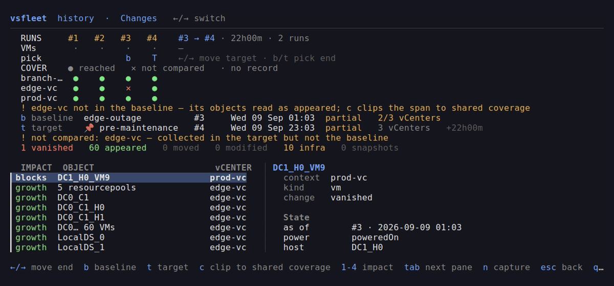

# vsfleet

<p align="center">
  <a href="https://github.com/Easonliuuuuu/vsfleet/releases"></a>
  <a href="https://easonliuuuuu.github.io/vsfleet/getting-started/#release-status"></a>
  <a href="https://github.com/Easonliuuuuu/vsfleet/actions/workflows/winget-status.yml"></a>
</p>

<p align="center">
  <strong>Read-only vSphere estate assessment and diagnostics across every vCenter.</strong><br>
  <sub>Inspect, assess migration readiness, and track what changed &mdash; from Linux, macOS, or Windows, with no GUI or .NET runtime.</sub>
</p>

<p align="center">
  <picture>
    <source media="(prefers-reduced-motion: reduce)" srcset="docs/assets/vsfleet.png">
    
  </picture>
</p>

<p align="center"><sub>Explore a synthetic estate: connection setup, VM details and timeline, networks, vApps, and search.</sub></p>

<p align="center">
  <a href="#why-vsfleet">Why vsfleet?</a> &bull;
  <a href="#installation">Installation</a> &bull;
  <a href="#quick-start">Quick Start</a> &bull;
  <a href="#documentation">Documentation</a>
</p>

---

## Why vsfleet?

Managing multiple VMware vCenters traditionally requires juggling browser tabs, coping with slow web interfaces, or maintaining brittle scripts that fail completely when a single endpoint is unreachable.

**vsfleet** organizes each vCenter into a named **context**—similar to a `kubectl` context—keeping endpoints, credentials, network routes, and certificate policies strictly separated:

-  **Estate-Wide Multi-vCenter Queries**: Query every configured vCenter in parallel with a single command using `--all-contexts`.
-  **Partial Failure Resilience**: Unreachable or timing-out sites do not block results; healthy vCenters remain responsive and usable.
-  **Strict Read-Only Safety**: Never powers VMs on or off, reverts snapshots, modifies networks, or alters inventory. See [SECURITY.md](SECURITY.md).
-  **Independent Proxy Routing**: Route each context independently through direct TCP, SOCKS5, HTTP, or HTTPS CONNECT proxies, with optional TLS thumbprint pinning.
-  **Secure Credential Handling**: Zero plaintext passwords in `config.toml`. Resolves credentials via native OS keyrings, interactive prompts, or unattended sources.
-  **Historical Drift & RVTools-Compatible Exports**: Capture immutable local SQLite snapshots, track drift over time, and export 25-sheet Excel workbooks for migration sizing ([details](docs/assessments.md#deterministic-exports)).
-  **Distributed-Network Readiness**: Compare cross-cluster VLAN mappings, policy, MTU, host coverage, and affected VMs before migration.
-  **Interactive TUI + Scriptable JSON**: Fast Bubble Tea terminal UI with local workstation handoffs (SSH, web browser, clipboard) alongside structured JSON for automation.

### Feature comparison

| Capability | `vsfleet` | `govc` | PowerCLI | vSphere Web Client |
|---|:---:|:---:|:---:|:---:|
| Multi-vCenter query in one command | **Yes** | No | Yes | No |
| Estate-wide resource search, every kind at once | **Yes** | No | Per cmdlet | Per vCenter |
| Partial results when one site fails | **Yes** | No | Custom error handling | Browser timeout |
| Per-context proxy routing | **Yes** | Global env | Global env | Browser proxy |
| Read-only safety guarantee | **Yes** | No | No | No |
| Historical drift and snapshot age | **Yes** | Export only | Custom script | Point-in-time |

<sub>`govc` and PowerCLI are full read-write toolkits; vsfleet deliberately is not.</sub>

---

## Installation

Choose the installation method for your operating system:

| Platform | Install |
| --- | --- |
| macOS or Linux with Homebrew | `brew install easonliuuuuu/tap/vsfleet` |
| Windows 10/11 | `winget install --id Easonliuuuuu.vsfleet --exact` |
| Debian or Ubuntu | [Download and install a `.deb` package](https://easonliuuuuu.github.io/vsfleet/getting-started/#linux-packages-debian-ubuntu-rhel-fedora) |
| RHEL or Fedora | [Download and install an `.rpm` package](https://easonliuuuuu.github.io/vsfleet/getting-started/#linux-packages-debian-ubuntu-rhel-fedora) |

Scoop, release archives, and `go install` are covered in [Getting Started](https://easonliuuuuu.github.io/vsfleet/getting-started/).

For unattended CLI commands and CI, use the container image (Linux amd64 and arm64):

```sh
docker run --rm ghcr.io/easonliuuuuu/vsfleet:latest compatibility report --sheet vInfo -o json
```

The interactive TUI needs the native binary; see the [Containers guide](https://easonliuuuuu.github.io/vsfleet/containers/) for running the image.

---

## Quick Start

### 1. Test drive without a vCenter

```sh
vsfleet --version
vsfleet demo
```

Check the installation, then open the TUI on a synthetic three-vCenter estate, with no configuration, credentials, or network access. Press `?` for help and `q` to quit.

### 2. Connect your first vCenter

Run `vsfleet`. With no contexts configured, it opens the interactive setup wizard, and you can add more vCenters from inside the TUI later.

Name the context `prod` to follow the examples below, or substitute your chosen name. Use a read-only account; see [Getting Started](https://easonliuuuuu.github.io/vsfleet/getting-started/#first-context) for certificate and credential choices.

```sh
# Open the TUI; the setup wizard starts when no contexts exist
vsfleet
```

To open the wizard directly, or to check a context from the command line:

```sh
# Launch the setup wizard
vsfleet context add

# Test connectivity, routes, and authentication
vsfleet context test prod
```

### 3. Search and inspect inventory

```sh
# Open the interactive terminal UI
vsfleet

# List specific resources
vsfleet vm list
vsfleet host list --context prod
vsfleet vm list --context prod -o json

# Search across every configured vCenter at once
vsfleet search ubuntu --all-contexts
```

### 4. Capture and export

```sh
vsfleet assessment run --all-contexts --label first-capture
vsfleet assessment report latest
vsfleet assessment export --format rvtools --file estate.xlsx
```

The report and workbook read the saved capture. After taking another capture, [compare runs and inspect trends](https://easonliuuuuu.github.io/vsfleet/assessments/#compare-runs).

> [!NOTE]
> vsfleet is a personal project, not affiliated with or endorsed by Dell Technologies; its RVTools-compatible export is an independent interoperability implementation.

---

## Documentation

The full operator guide is published at **[easonliuuuuu.github.io/vsfleet](https://easonliuuuuu.github.io/vsfleet/)**:

| Guide | Description |
|---|---|
|  **[Getting Started](https://easonliuuuuu.github.io/vsfleet/getting-started/)** | Installation, first configuration, shell completion |
|  **[CLI Guide](https://easonliuuuuu.github.io/vsfleet/commands/)** | Commands, flags, filters, JSON output |
|  **[Terminal UI](https://easonliuuuuu.github.io/vsfleet/tui/)** | Keybindings, filtering, workstation actions |
|  **[Containers](https://easonliuuuuu.github.io/vsfleet/containers/)** | Docker, Kubernetes, CI automation |
|  **[Assessments & History](https://easonliuuuuu.github.io/vsfleet/assessments/)** | Captures, diffs, trends, export formats |
|  **[Configuration](https://easonliuuuuu.github.io/vsfleet/configuration/)** | Proxies, TLS thumbprints, credential sources |
|  **[Operator Recipes](https://easonliuuuuu.github.io/vsfleet/recipes/)** | Real-world workflows and pipelines |
|  **[Troubleshooting](https://easonliuuuuu.github.io/vsfleet/troubleshooting/)** | `vsfleet doctor` and common fixes |
|  **[Architecture](https://easonliuuuuu.github.io/vsfleet/architecture/)** | Concurrency, session caching, security invariants |

---

## Contributing and security

See [CONTRIBUTING.md](CONTRIBUTING.md) for development and testing, and the [Synthetic Testbed](https://easonliuuuuu.github.io/vsfleet/testbed/) guide for scenarios and PTY journeys. See [SECURITY.md](SECURITY.md) for credential handling, read-only guarantees, and vulnerability reporting.

---

## License

[MIT](LICENSE) © Eason Liu
